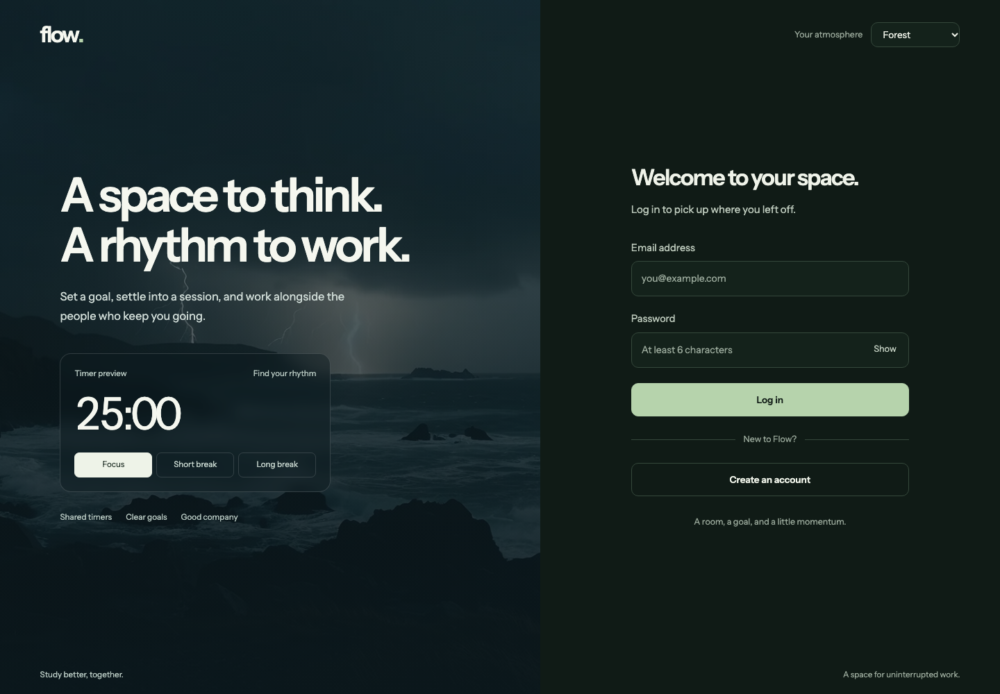
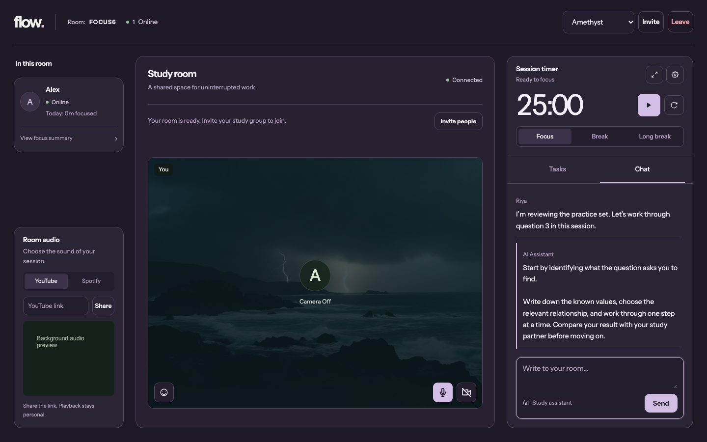

# Flow.

[](https://github.com/ManasDasri/Flow-study/actions/workflows/ci.yml)
[](https://nodejs.org/)
[](https://flow-study.me)

A shared study room for focused work. Bring your group, set a timer, and work through your goals together.



## Inside a room

- **Shared focus timer:** focus, short break, and long break modes with adjustable durations, room updates, and a distraction-free view.
- **Study partners:** camera and microphone controls, presence, reactions, and peer-to-peer WebRTC calls.
- **Shared tasks:** add, assign, complete, and remove room goals with persistent storage.
- **Room chat:** send messages and ask the study assistant with `/ai`.
- **Room audio:** share YouTube or Spotify content links through official embedded players. Everyone controls their own playback; playheads are not synchronized.
- **Your focus:** the room card and profile include live focus from this visit. Pauses do not count. Completed focus sessions are saved to your history; unsaved progress is lost on refresh or leaving the page.
- **Five atmospheres:** Forest, Midnight, Warm, Aqua, and Amethyst, with responsive tools, keyboard navigation, and reduced-motion support.
- **Leave and rejoin:** confirm before disconnecting, then return using the room code and PIN. Saved tasks remain in the room.



## Run locally

Use Node.js 22, 24, or 26. CI exercises all three.

```sh
git clone https://github.com/ManasDasri/Flow-study.git
cd Flow-study
npm ci
cp .env.example .env
npm start
```

Open `http://localhost:3000`. Set `PORT` to use another port.

The browser connects to the Supabase project configured in [`public/js/modules/supabase.js`](public/js/modules/supabase.js). For your own deployment, replace its project URL and **public publishable/anon key** with your project's values. Never put a service-role key in browser code.

### Server configuration

| Variable | Purpose |
| --- | --- |
| `PORT` | HTTP port; defaults to `3000` |
| `GROQ_API_KEY` | Optional; enables `/api/ai` for study-assistant questions |
| `TWILIO_ACCOUNT_SID` | Optional; used with the auth token to obtain TURN credentials |
| `TWILIO_AUTH_TOKEN` | Optional; server-side Twilio credential |

Keep `.env` out of version control. Without Groq, rooms still work and AI requests return a configuration message. Without TURN credentials, calls fall back to STUN and may fail across restrictive networks. Spotify embeds require no application API key; available playback depends on Spotify, the user's account, and browser permissions. YouTube availability depends on the video's embedding permissions.

### Supabase setup

Enable email/password authentication and configure your site URL, redirect URLs, and confirmation email delivery. The UI supports both immediate sessions and email-confirmation flows.

For a **new, empty database**, run these files in order in the Supabase SQL editor:

1. [`sql/schema.sql`](sql/schema.sql)
2. [`sql/002_profiles.sql`](sql/002_profiles.sql)
3. [`sql/003_task_assignment.sql`](sql/003_task_assignment.sql)
4. [`sql/004_room_access_compatibility.sql`](sql/004_room_access_compatibility.sql)

**`schema.sql` drops existing tables. Do not run it as an upgrade on a database with data.** For an existing installation, use the additive migration sequence and compatibility notes in [TESTING.md](TESTING.md#supabase-compatibility).

The app uses profiles, rooms, room participants, tasks, sessions, the `join_room` RPC, and task Realtime updates. Migration 004 supports the older TEXT room references and the newer UUID schema, preserves existing rows, and scopes task access to room participants.

Database RLS protects table access. Private Realtime Broadcast authorization needs its own coordinated policies and client configuration; it is a separate production-hardening task.

## Shared-link preview

Both public pages include static Open Graph and large-image card metadata, with a branded 1200 × 630 PNG at `/social-preview.png`. Room invitations use the same generic preview; room codes and PINs are not included in the card metadata.

The artwork source is [`scripts/social-preview.html`](scripts/social-preview.html). After editing it, regenerate the committed image:

```sh
npx playwright install chromium
npm run preview:social
```

Generation loads Instrument Sans from Google Fonts; the deployed PNG has no font or browser dependency. CI checks that crawlers can fetch the metadata and correctly sized image without authentication. Social apps control their own preview caches, so existing shared links may take time to refresh.

## Architecture

The frontend is HTML, CSS, and browser JavaScript modules. Instrument Sans and an outlined `f.` mark provide the visual identity.

Express serves the site and the AI/TURN endpoints. Supabase handles authentication, PostgreSQL persistence, task changes, presence, and room broadcasts. WebRTC carries camera and microphone media between peers, with TURN relay support when configured. Groq handles assistant requests through the server. Room chat and broadcasts are transient; tasks, profiles, and completed sessions are stored.

## Checks and CI

```sh
npm test
npx playwright install chromium
npm run test:browser
```

The browser command starts and stops its own local server. It tests login through leaving/rejoining a room with isolated Supabase/provider fixtures and synthetic media. No live user data, camera, microphone, or paid provider calls are used.

For database tests, start an isolated local PostgreSQL server with a test superuser named `flow_test`:

```sh
FLOW_TEST_PGPORT=55439 npm run test:db
```

The database suite creates and removes throwaway databases on `127.0.0.1`. See [TESTING.md](TESTING.md) for setup, coverage, and integration limits.

GitHub Actions runs on pull requests to `main`, pushes/merges to `main`, and manual dispatch:

| Check | What it verifies |
| --- | --- |
| Node.js 22 / 24 / 26 | JavaScript parsing, HTTP boundaries, local concurrency, URL validation, and focus accounting |
| PostgreSQL 17 | Both schema variants, migration repeatability, preserved data, room/PIN access, and task policies |
| Chromium | Complete interactive flows, failure recovery, stress fixtures, and ten responsive tool layouts |
| Dependency audit | Production dependencies fail the job on reported high/critical vulnerabilities |

Browser screenshots, results, and failure traces are uploaded as `browser-diagnostics` and retained for seven days. A failing check marks the run red. To block merges, configure the desired checks as required in the repository's branch rules.

## Deploy

For free CDN hosting, use the included `vercel.json`: the `public` directory is served directly by the CDN, and the two files in `api` expose the existing Express endpoints as Node functions. This keeps Render's web-service startup out of page loads. See [HOSTING.md](HOSTING.md) for credentials, domain cutover, verification, and rollback.

Conventional Node hosting remains supported with `npm ci --omit=dev` and `npm start`. Serve the public site over HTTPS for camera/microphone access. Keep server credentials in the host's secret settings.

Before a wider launch, validate live authentication, two-account room behavior, physical media across networks, TURN, provider success paths, and browser compatibility. Local fixture stress checks are documented measurements, not a hosted-capacity guarantee.
